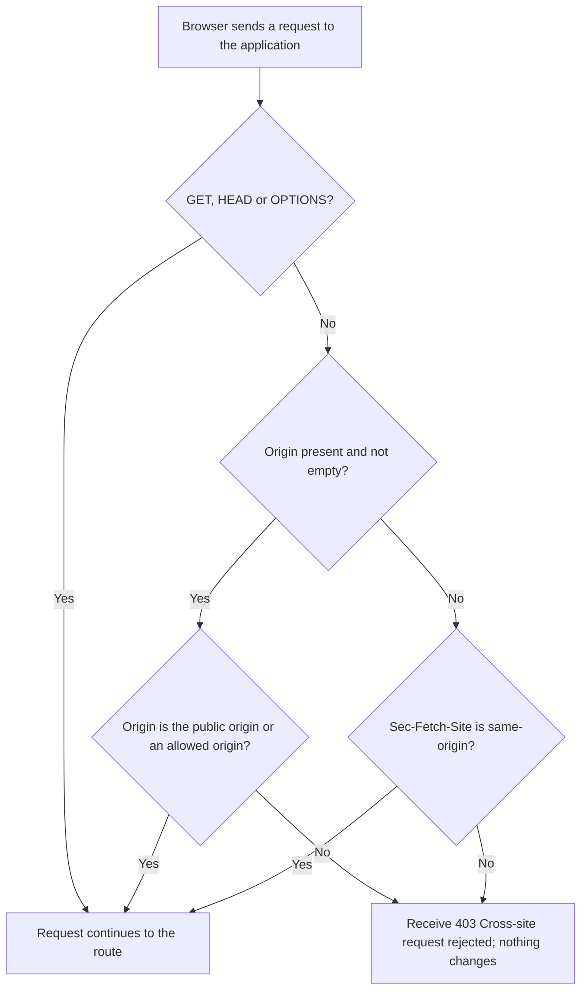
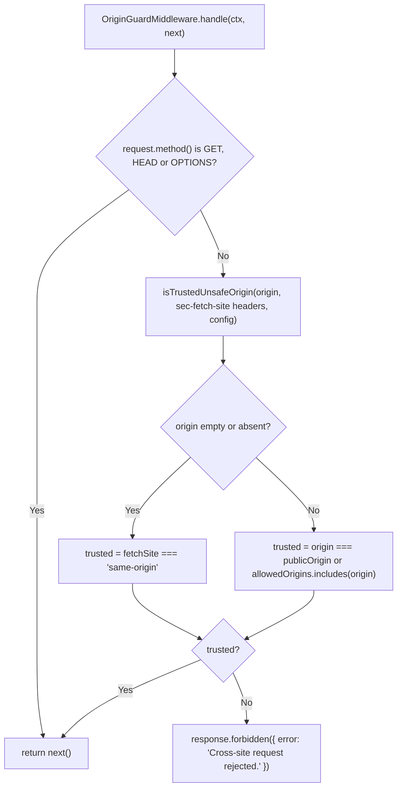

# US-ORIGIN-01 — Refuse cross-site writes

As an application developer, I want every write that a browser sends from another site refused before it reaches my routes so that a signed-in user cannot be made to change data from a hostile page, without issuing or checking a CSRF token.

**Status:** Current.
**Access:** Application developer who controls `start/kernel.ts` and the host's origin settings. Applies to every request through the server middleware stack.
**Entry:** `createOriginGuard({ publicOrigin, allowedOrigins })`, default-exported from a host middleware file and registered with `server.use`. `isTrustedUnsafeOrigin(headers, config)` is the same decision as a function.
**Documentation:** [Refuse cross-site writes](../README.md#refuse-cross-site-writes).
**Source:** [guard](../src/guard.ts).
**Coverage:** [Guard tests](../tests/guard.spec.ts).

## Acceptance criteria

| Input            | Control                            | Required/default/conditions                                                                                                                                    |
| ---------------- | ---------------------------------- | -------------------------------------------------------------------------------------------------------------------------------------------------------------- |
| `publicOrigin`   | `OriginGuardConfig.publicOrigin`   | Required. The origin the application is served from, in the serialized form browsers send; [US-ORIGIN-02](US-ORIGIN-02-validate-public-origin.md) produces it. |
| `allowedOrigins` | `OriginGuardConfig.allowedOrigins` | Optional; defaults to none. Further exact origins trusted for writes, for example the [parsed CORS list](US-ORIGIN-03-parse-trusted-origins.md).               |
| `Origin`         | Request header                     | Compared as sent; nothing is normalised. An empty value counts as absent.                                                                                      |
| `Sec-Fetch-Site` | Request header                     | Read only when `Origin` is absent or empty; only `same-origin` is accepted.                                                                                    |

- `GET`, `HEAD` and `OPTIONS` pass through without reading either header.
- Any other method is accepted when `Origin` equals the public origin or an allowed origin exactly, or when `Origin` is absent or empty and `Sec-Fetch-Site` is `same-origin`.
- Every other write, including `Origin: null`, a `same-site` or `cross-site` fetch without `Origin`, and a request with neither header, is refused with `403` and `{ "error": "Cross-site request rejected." }`; the rest of the stack does not run.
- `Host` and the request protocol are never consulted. A non-browser client that sends neither header must send `Origin`.
- The host turns off Shield's token-based CSRF if this guard replaces it; the package does not.

## User flow

## Code flow

Scope: package middleware decision; registering it, choosing the origins and disabling Shield CSRF are host-owned.

**Code references:** [createOriginGuard](../src/guard.ts#L37), [isTrustedUnsafeOrigin](../src/guard.ts#L24), [OriginGuardConfig](../src/guard.ts#L5).
