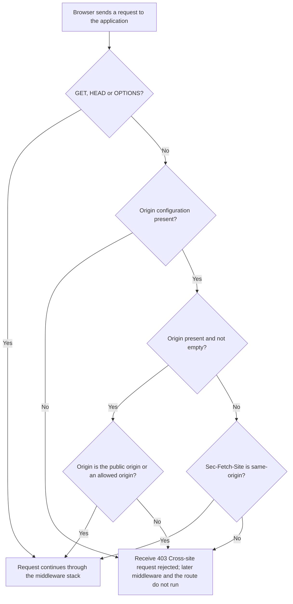
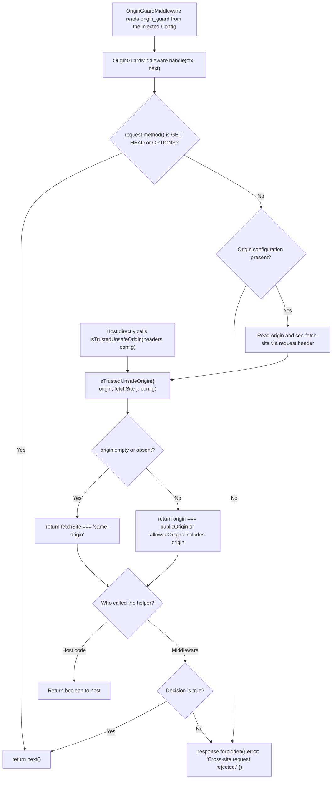

# US-ORIGIN-01 — Refuse cross-site writes

As an application developer, I want browser writes from untrusted origins refused before they reach my routes so that a hostile page cannot make a signed-in user change data, without issuing or checking a CSRF token.

**Status:** Current.
**Access:** Application developer who controls `start/kernel.ts` and the host's origin settings. Applies to every request through the server middleware stack. Hosts can also call the exported decision helper directly.
**Entry:** [Ace configure](US-ORIGIN-05-install-and-start.md) registers the package middleware in `start/kernel.ts`. Hosts can call `isTrustedUnsafeOrigin({ origin, fetchSite }, config)` directly to get a boolean for the two optional headers.
**Documentation:** [Refuse cross-site writes](../README.md#refuse-cross-site-writes).
**Source:** [Middleware](../src/origin_guard_middleware.ts) and [origin decision](../src/origin_check.ts).
**Coverage:** [Origin-check tests](../tests/origin_check.spec.ts).

## Acceptance criteria

| Input            | Control                            | Required/default/conditions                                                                                                                                                                   |
| ---------------- | ---------------------------------- | --------------------------------------------------------------------------------------------------------------------------------------------------------------------------------------------- |
| `publicOrigin`   | `OriginGuardConfig.publicOrigin`   | Required. A validated origin the application is served from, in the serialized form browsers send; [US-ORIGIN-02](US-ORIGIN-02-validate-public-origin.md) produces it during host startup.    |
| `allowedOrigins` | `OriginGuardConfig.allowedOrigins` | Optional; defaults to none. Further validated serialized origins trusted for writes, for example the [parsed CORS list](US-ORIGIN-03-parse-trusted-origins.md), produced during host startup. |
| `Origin`         | Request header                     | Compared as sent; nothing is normalised. An empty value counts as absent.                                                                                                                     |
| `Sec-Fetch-Site` | Request header                     | Decides the result only when `Origin` is absent or empty; only `same-origin` is accepted.                                                                                                     |

- `GET`, `HEAD` and `OPTIONS` pass through without reading either header.
- A non-empty Origin decides the outcome even when Sec-Fetch-Site disagrees. Any other method is accepted when `Origin` equals the public origin or an allowed origin exactly, or when `Origin` is absent or empty and `Sec-Fetch-Site` is `same-origin`.
- If the middleware has no `origin_guard` configuration, unsafe requests are refused without reading the headers.
- Every other write, including `Origin: null`, a `same-site` or `cross-site` fetch without `Origin`, and a request with neither header, is refused with `403` and `{ "error": "Cross-site request rejected." }`; the rest of the stack does not run.
- `Host` and the request protocol are never consulted. A non-browser client without fetch metadata can supply a trusted `Origin`.
- The host supplies validated configuration at startup. The middleware compares request headers with that configuration and does not revalidate configured origins per request.
- The host turns off Shield's token-based CSRF if this middleware replaces it; the package does not. The host must keep GET, HEAD and OPTIONS free of state-changing actions and apply authentication and authorisation separately.

## User flow

## Code flow

Scope: the package middleware and standalone origin decision. The application owns its trusted origins and Shield configuration.

**Code references:** [OriginGuardMiddleware](../src/origin_guard_middleware.ts), [isTrustedUnsafeOrigin](../src/origin_check.ts), [OriginGuardConfig](../src/types.ts).
