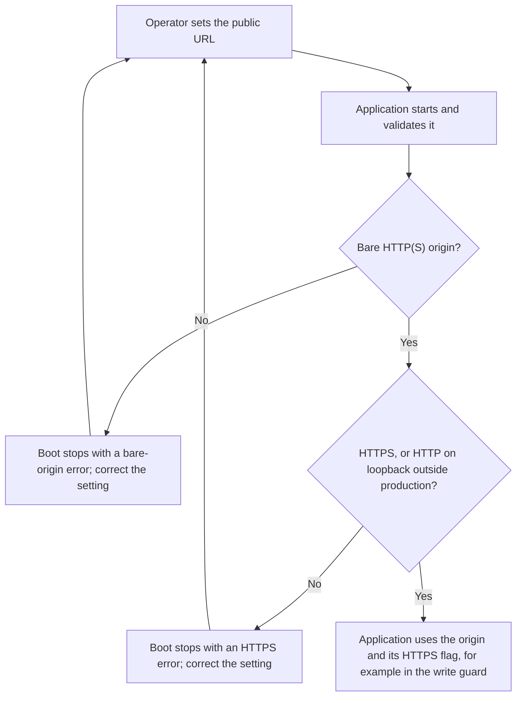
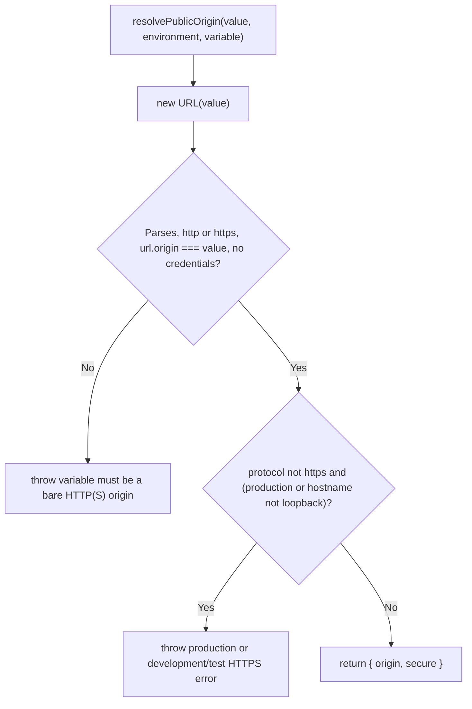

# US-ORIGIN-02 — Validate the public origin

As an application operator, I want the origin my application is served from checked when the application starts so that a malformed or insecure setting stops the boot instead of weakening the write guard.

**Status:** Operator.
**Access:** Operator who sets the host's public URL setting (for example `APP_URL`); host code passes it in, since the package reads no environment variable.
**Entry:** `resolvePublicOrigin(value, environment, variable)`, called from host code such as the guard's middleware file.
**Documentation:** [Parse origins](../README.md#parse-origins).
**Source:** [origins](../src/origins.ts).
**Coverage:** [Origin tests](../tests/origins.spec.ts).

## Acceptance criteria

| Input         | Control    | Required/default/conditions                                                                         |
| ------------- | ---------- | --------------------------------------------------------------------------------------------------- |
| `value`       | Argument 1 | Required. Must already be a bare serialized HTTP(S) origin: no trailing slash, path or credentials. |
| `environment` | Argument 2 | Required. `production`, `development` or `test`.                                                    |
| `variable`    | Argument 3 | Required. The setting's name, used only in error messages.                                          |

- A valid value returns `{ origin, secure }`, where `secure` is true for HTTPS.
- HTTPS is required in production. Plain HTTP is accepted in development and test only on `localhost`, `127.0.0.1` or `[::1]`.
- A value that does not parse, is not HTTP(S), carries credentials or differs from its serialized origin throws `<variable> must be a bare HTTP(S) origin`.
- Plain HTTP throws `<variable>: public production origins require HTTPS` in production, and `<variable> must use HTTPS outside loopback in development/test` elsewhere. The host corrects the setting and restarts.

## User flow

## Code flow

Scope: package validation; reading the setting and using `secure` are host-owned.

**Code references:** [resolvePublicOrigin](../src/origins.ts#L53), [PublicOrigin](../src/origins.ts#L2).
