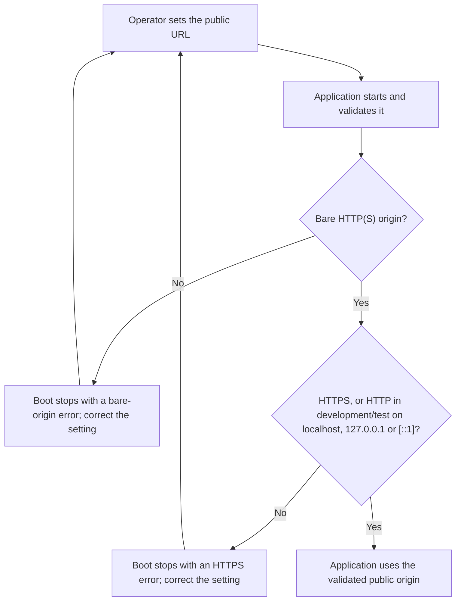
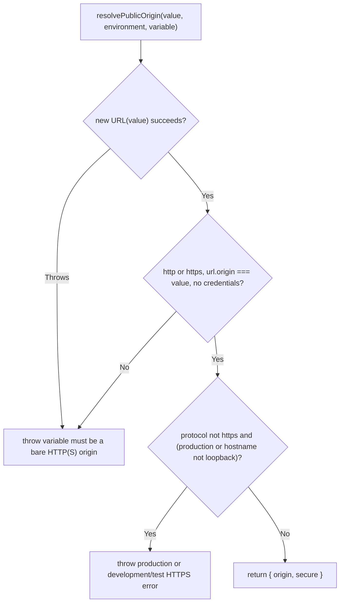

# US-ORIGIN-02 — Validate the public origin

As an application operator, I want the origin my application is served from checked when the application starts so that a malformed or insecure setting stops the boot instead of weakening the origin check.

**Status:** Operator.
**Access:** Operator who sets the public origin in the environment. The app reads the setting in `config/origin_guard.ts`.
**Entry:** `resolvePublicOrigin(value, environment, variable)`; `defineConfig` calls it during application boot. Hosts may also call it directly.
**Documentation:** [Parse origins](../README.md#parse-origins).
**Source:** [origins](../src/origins.ts).
**Coverage:** [Origin tests](../tests/origins.spec.ts).

## Acceptance criteria

| Input         | Control    | Required/default/conditions                                                                                                                               |
| ------------- | ---------- | --------------------------------------------------------------------------------------------------------------------------------------------------------- |
| `value`       | Argument 1 | Required. Must exactly equal its own `new URL(value).origin`, for example `https://app.example`: no credentials, trailing slash, path, query or fragment. |
| `environment` | Argument 2 | Required. `production`, `development` or `test`.                                                                                                          |
| `variable`    | Argument 3 | Required. The setting's name, used only in error messages.                                                                                                |

- A valid value returns `{ origin, secure }`, where `secure` is true for HTTPS.
- HTTPS is required in production. Plain HTTP is accepted in development and test only on `localhost`, `127.0.0.1` or `[::1]`.
- The configure hook declares `ORIGIN_GUARD_PUBLIC_ORIGIN` in the app environment schema and the generated config reads it.
- A value that does not parse, is not HTTP(S), carries credentials or differs from its serialized origin throws `<variable> must be a bare HTTP(S) origin` as `InvalidArgumentsException`. When called by `defineConfig`, this stops application boot.
- `InvalidArgumentsException` for plain HTTP reports `<variable>: public production origins require HTTPS` in production. In development and test it throws `<variable> must use HTTPS outside loopback in development/test` unless the hostname is `localhost`, `127.0.0.1` or `[::1]`. The host corrects the setting and retries; the startup example requires a restart.

The comparison uses the complete input string. Host case, an explicit default port or a trailing slash that changes on serialisation fails the bare-origin check. A canonical non-default port remains part of the origin.

## User flow

## Code flow

Scope: package validation; reading the setting and using `secure` are host-owned.

**Code references:** [defineConfig](../src/define_config.ts), [resolvePublicOrigin](../src/origins.ts), [PublicOrigin](../src/types.ts).
