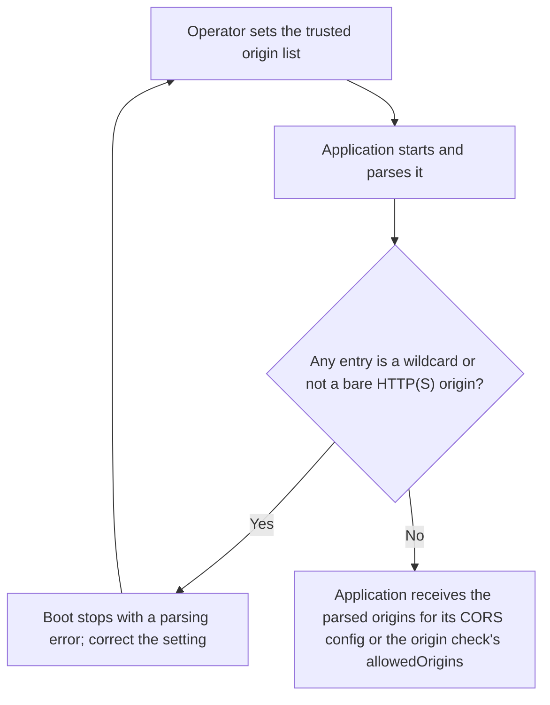
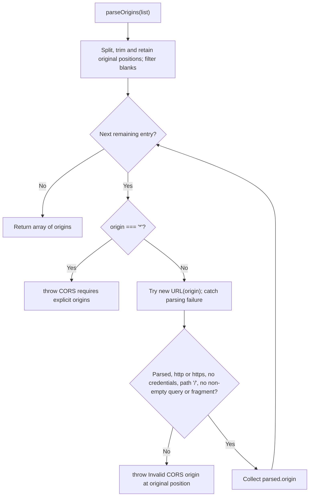

# US-ORIGIN-03 — Parse the trusted origin list

As an application operator, I want a comma-separated list of trusted origins validated and normalised when the application starts so that CORS and the origin check trust exactly the origins I meant, never a wildcard.

**Status:** Operator.
**Access:** Operator who sets `ORIGIN_GUARD_ALLOWED_ORIGINS`; the application reads the setting in `config/origin_guard.ts`.
**Entry:** `parseOrigins(list)`; `defineConfig` calls it during application boot. Hosts may also call it directly.
**Documentation:** [Parse origins](../README.md#parse-origins).
**Source:** [origins](../src/origins.ts).
**Coverage:** [Origin tests](../tests/origins.spec.ts).

## Acceptance criteria

| Input  | Control    | Required/default/conditions                                                                                    |
| ------ | ---------- | -------------------------------------------------------------------------------------------------------------- |
| `list` | Argument 1 | Required string. Comma-separated; entries are trimmed and blank entries skipped. An empty string returns `[]`. |

- Each entry is returned in the serialized form a browser sends in `Origin` (for example a trailing `/` is dropped and the host is lower-cased).
- `*` throws `InvalidArgumentsException` with `CORS requires explicit origins when credentials are enabled`.
- An entry that does not parse as an HTTP(S) URL, or that after WHATWG parsing has credentials, a path other than `/`, a non-empty query or a non-empty fragment, throws `InvalidArgumentsException` with `Invalid CORS origin at position <n>: expected a bare HTTP(S) origin`. The rejected value is omitted from diagnostics. The host corrects the setting and retries; the documented startup wiring requires a restart.
- Accepted spellings are returned as `URL.origin`, so host case, default ports and a trailing root slash are normalized by WHATWG URL parsing before validation and return.
- Unlike the public-origin validator, the list parser has no environment argument and accepts HTTP as well as HTTPS. The host selects which origins it trusts.

The returned array preserves entry order and duplicates. Parsing stops at the first invalid non-blank entry. Its one-based position counts blank fields in the original comma-separated input. The wildcard has its own diagnostic without a position.

## User flow

## Code flow

Scope: package parsing. `defineConfig` uses its return value for the write allowlist; reuse in CORS is host-owned.

**Code references:** [defineConfig](../src/define_config.ts), [parseOrigins](../src/origins.ts).
