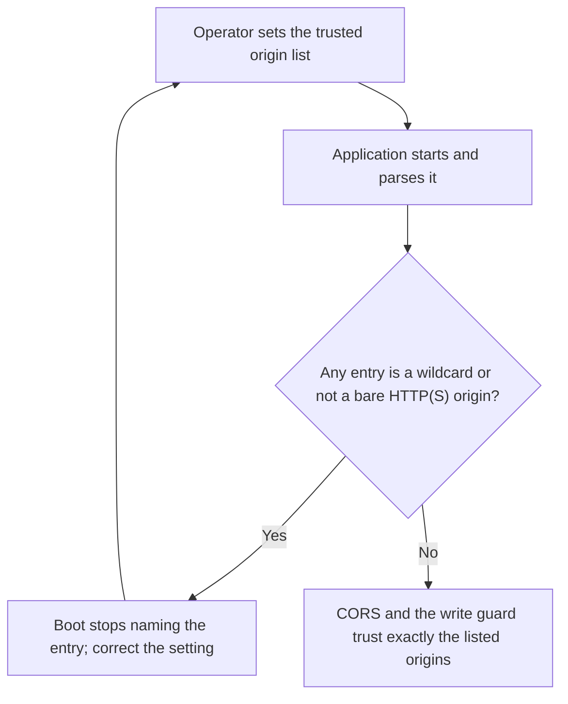
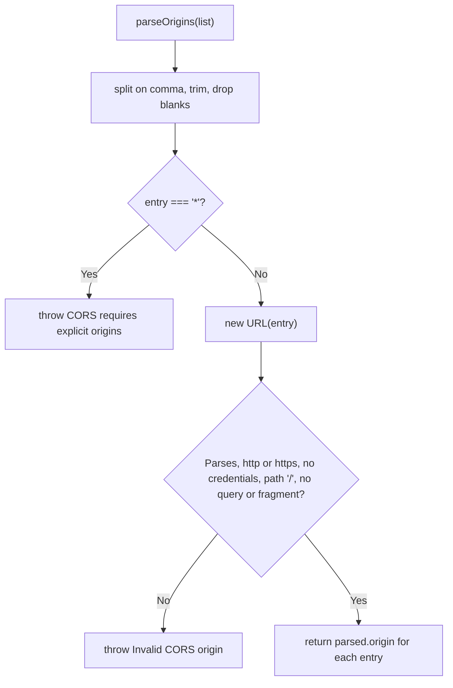

# US-ORIGIN-03 — Parse the trusted origin list

As an application operator, I want a comma-separated list of trusted origins validated and normalised when the application starts so that CORS and the write guard trust exactly the origins I meant, never a wildcard.

**Status:** Operator.
**Access:** Operator who sets the host's trusted-origin setting (for example `CORS_ORIGINS`); host code passes it in.
**Entry:** `parseOrigins(list)`, called from host code such as the guard's middleware file or CORS config.
**Documentation:** [Parse origins](../README.md#parse-origins).
**Source:** [origins](../src/origins.ts).
**Coverage:** [Origin tests](../tests/origins.spec.ts).

## Acceptance criteria

| Input  | Control    | Required/default/conditions                                                                                    |
| ------ | ---------- | -------------------------------------------------------------------------------------------------------------- |
| `list` | Argument 1 | Required string. Comma-separated; entries are trimmed and blank entries skipped. An empty string returns `[]`. |

- Each entry is returned in the serialized form a browser sends in `Origin` (for example a trailing `/` is dropped and the host is lower-cased).
- `*` throws `CORS requires explicit origins when credentials are enabled`.
- An entry that does not parse, is not HTTP(S), or has credentials, a path, a query or a fragment throws `Invalid CORS origin "<entry>": expected a bare HTTP(S) origin`. The host corrects the setting and restarts.

## User flow

## Code flow

Scope: package parsing; passing the result to CORS or `createOriginGuard` is host-owned.

**Code references:** [parseOrigins](../src/origins.ts#L13).
