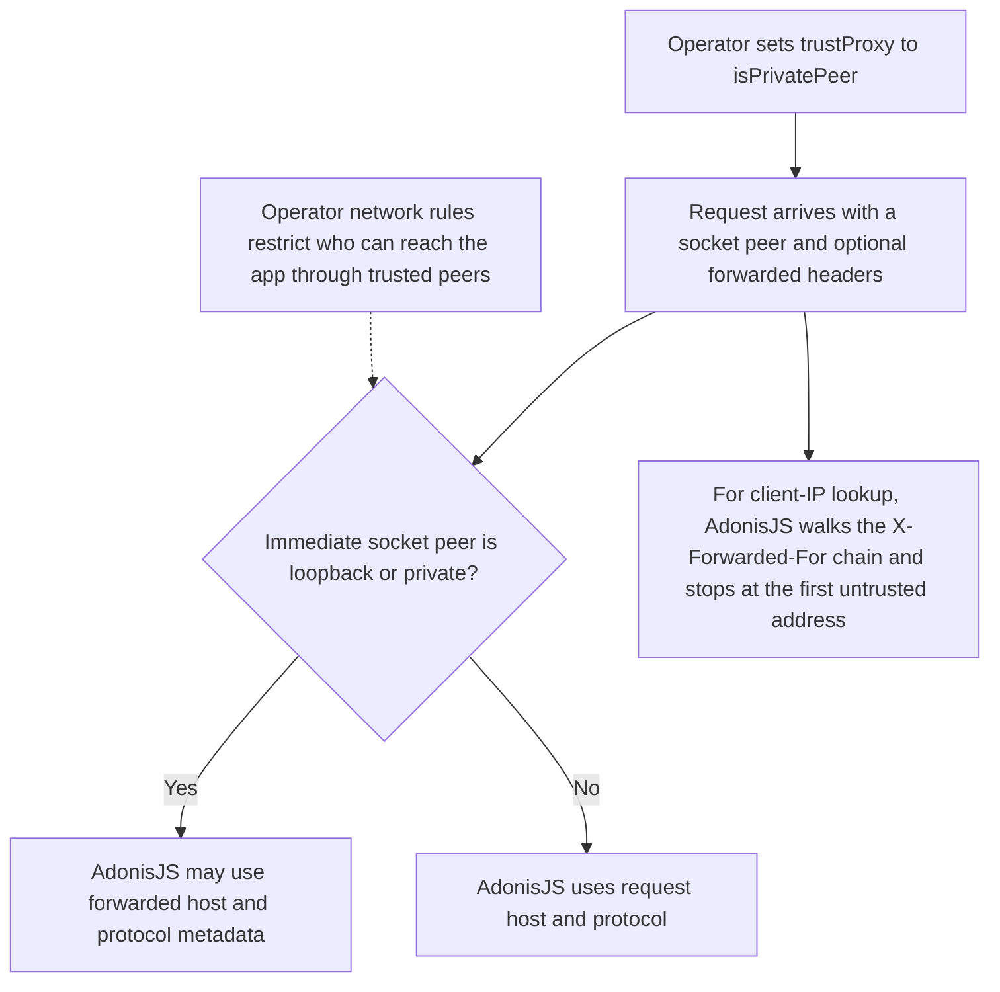
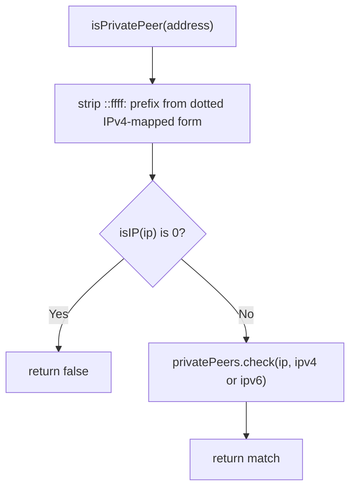

# US-ORIGIN-04 — Trust a proxy on a private network

As an application operator, I want AdonisJS to trust forwarded headers only from loopback or private-network addresses so that it can use the client address and protocol supplied by a reverse proxy on the same host or network.

**Status:** Operator.
**Access:** Operator who controls `config/app.ts` and the proxy placement.
**Entry:** `isPrivatePeer(address)`, passed as AdonisJS's `http.trustProxy` option.
**Documentation:** [Trust a proxy](../README.md#trust-a-proxy).
**Source:** [private peer check](../src/private_peer.ts).
**Coverage:** [Private peer tests](../tests/private_peer.spec.ts).

## Acceptance criteria

| Input     | Control    | Required/default/conditions                    |
| --------- | ---------- | ---------------------------------------------- |
| `address` | Argument 1 | Required. The peer address AdonisJS passes in. |

- Returns true for `127.0.0.0/8`, `10.0.0.0/8`, `172.16.0.0/12`, `192.168.0.0/16`, `::1` and `fc00::/7`, including IPv4-mapped IPv6 such as `::ffff:10.0.0.1`.
- Returns false for every other address, and for anything that is not an IP address. It never throws.
- AdonisJS checks the immediate socket peer when deciding whether to use forwarded host and protocol metadata. Its client-IP lookup can walk the `X-Forwarded-For` address chain and stops at the first untrusted address.
- Which networks a deployment's proxy uses, and whether a private peer is trustworthy there, stay the operator's decision.
- The operator must ensure untrusted clients cannot supply forwarded headers through a peer accepted by this predicate. Use a predicate limited to the intended proxy peers when private address ranges include untrusted systems.

## User flow

## Code flow

Scope: package address check; applying forwarded headers is AdonisJS's `trustProxy` handling.

**Code references:** [isPrivatePeer](../src/private_peer.ts#L16).
