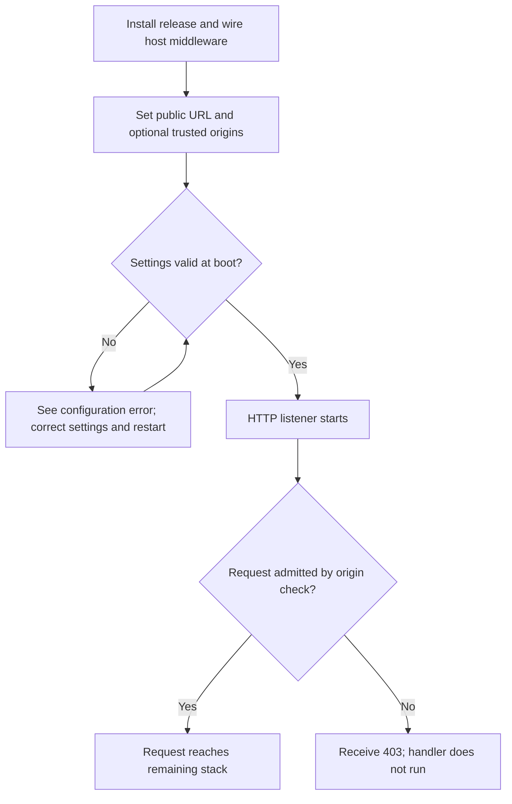
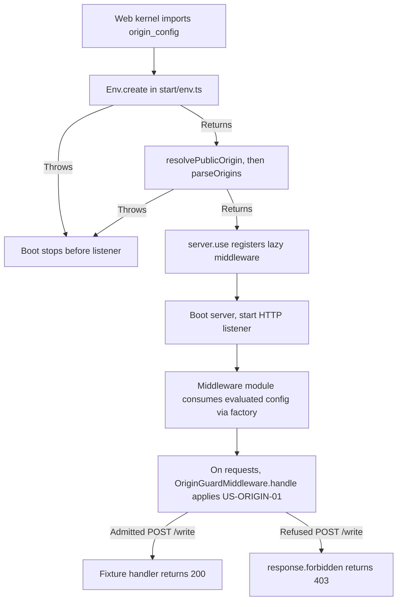

# US-ORIGIN-05 — Install the origin-check middleware and validate settings before serving requests

As an application developer, I want the HTTP kernel to evaluate my trust settings during startup so that a configuration error surfaces before the first write.

**Status:** Operator.
**Access:** Developer with control of the host application, its dependencies and its HTTP kernel.
**Entry:** Install the GitHub release tarball and register the returned middleware class with `server.use`.
**Documentation:** [Installation and host wiring](../README.md#install).
**Source:** [Package exports](../index.ts), [type entry](../src/types.ts), [manifest](../package.json).
**Coverage:** [Web startup fixture](../tests/origins/origin_check/boot.spec.ts), which boots a host from the source, and [packed consumer checks](../bin/smoke_packed_package.sh), which check the packed types and construction without booting a host.

## Acceptance criteria

- The documented release installation targets Node 24+ and AdonisJS core 7. `createOriginGuard` and `createOriginCheck` are the same factory and the root and `./types` expose the same declarations for `OriginGuardConfig`, `PublicOrigin` and `UnsafeRequestHeaders`. There is no provider or configure hook.
- The host declares required `APP_URL` and optional `CORS_ORIGINS` in its environment schema. Its shared module validates the former with `NODE_ENV` and passes an empty string to the list parser when the latter is omitted.
- The kernel eagerly imports that module and registers a lazy middleware import ahead of handlers that act on writes. Invalid public URL or trusted-list settings stop startup before the HTTP listener without echoing the rejected value. An invalid public URL names its setting and a malformed list entry its position; a `*` entry reports neither. The operator corrects the setting and restarts.
- The module is imported by a preload file rather than living in `config/`, so the validation runs with the HTTP kernel, in the environments its preload entry lists, and not in every process that boots the application.
- With valid settings the host starts. On the fixture's POST endpoint an untrusted origin receives 403, and the public origin and each listed origin reach the handler and receive 200. With `CORS_ORIGINS` omitted the host starts with an empty allowlist. Of the three explicit origins in the fixture, only the public origin is admitted. The [header fallback](US-ORIGIN-01-refuse-cross-site-writes.md) still applies to requests with no or empty Origin. The host owns registration and the handler's success response.
- Hosts can call the exported parsing functions independently of middleware registration.

## User flow

## Code flow

Scope: host startup fixture and package middleware; the host owns registration, listener and route response.

**Code references:** [Fixture kernel](../tests/origins/origin_check/fixture/start/kernel.ts), [environment schema](../tests/origins/origin_check/fixture/start/env.ts), [shared config](../tests/origins/origin_check/fixture/start/origin_config.ts), [middleware module](../tests/origins/origin_check/fixture/start/middleware.ts), [boot harness](../tests/origins/origin_check/boot.spec.ts), [shared request flow](US-ORIGIN-01-refuse-cross-site-writes.md#code-flow).
