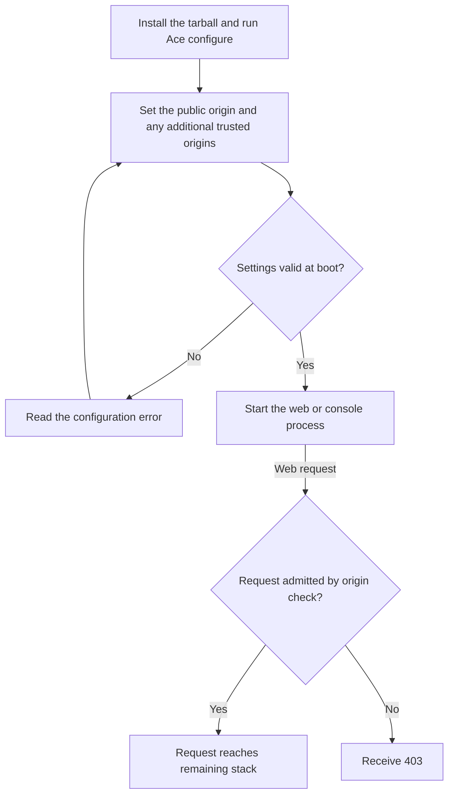
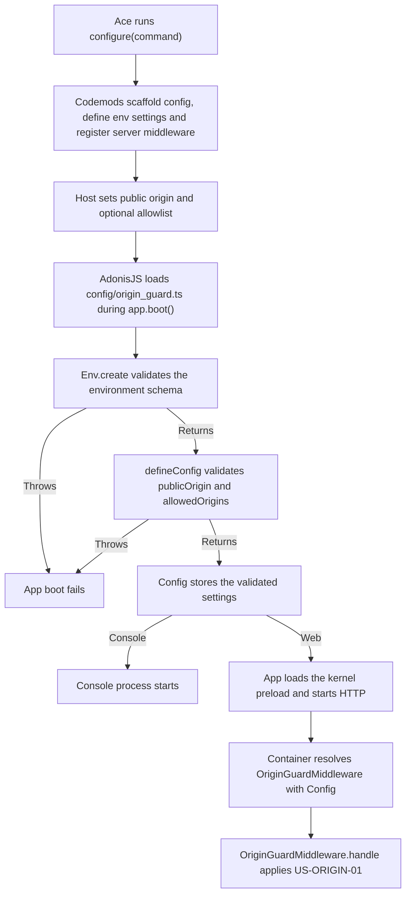

# US-ORIGIN-05 — Install the origin-check middleware and validate settings before serving requests

As an application developer, I want Ace to install the origin-check middleware and the application to validate my trust settings during boot so that errors surface before the first write.

**Status:** Operator.
**Access:** Developer who controls the host's installation and configuration.
**Entry:** Install a tarball built from the current source, then run `node ace configure @kevinjohn/adonisjs-origin-guard` from the app.
**Documentation:** [Installation and host settings](../README.md#install).
**Source:** [Configure hook](../configure.ts), [config stub](../stubs/config/origin_guard.stub), [defineConfig](../src/define_config.ts), [middleware](../src/origin_guard_middleware.ts).
**Coverage:** [Scratch application and startup tests](../tests/configure.spec.ts) and [packed consumer checks](../bin/smoke_packed_package.sh).

## Acceptance criteria

| Input                          | Control                 | Required/default/conditions                                                                                                                   |
| ------------------------------ | ----------------------- | --------------------------------------------------------------------------------------------------------------------------------------------- |
| `ORIGIN_GUARD_PUBLIC_ORIGIN`   | App environment setting | Required. No default. Canonical origin; [US-ORIGIN-02](US-ORIGIN-02-validate-public-origin.md) describes the HTTPS policy.                    |
| `ORIGIN_GUARD_ALLOWED_ORIGINS` | App environment setting | Optional. If omitted or empty, trusts no additional origins. [US-ORIGIN-03](US-ORIGIN-03-parse-trusted-origins.md) describes the list syntax. |

- Installation requires Node 24+ and AdonisJS core 7. The Ace configure command uses the host's assembler to create `config/origin_guard.ts`, add environment schema entries and register the lazy server middleware.
- Rerunning the command preserves host edits to the config and existing environment values without duplicating generated entries. The hook places the middleware at the start of the server stack on the first run.
- The application loads the config at boot, including for console processes that boot the app. An invalid configured origin causes `InvalidArgumentsException` before startup completes. Errors name the config key and withhold the rejected value. The operator corrects the setting and retries.
- With valid settings, POSTs with the public origin or a listed origin reach the fixture handler. A foreign origin receives 403 without reaching the handler. [US-ORIGIN-01](US-ORIGIN-01-refuse-cross-site-writes.md) describes the full request decision.

## User flow

## Code flow

**Code references:** [Configure hook](../configure.ts), [config stub](../stubs/config/origin_guard.stub), [defineConfig](../src/define_config.ts), [boot fixture](../tests/fixtures/application/boot.ts), [request flow](US-ORIGIN-01-refuse-cross-site-writes.md#code-flow).
