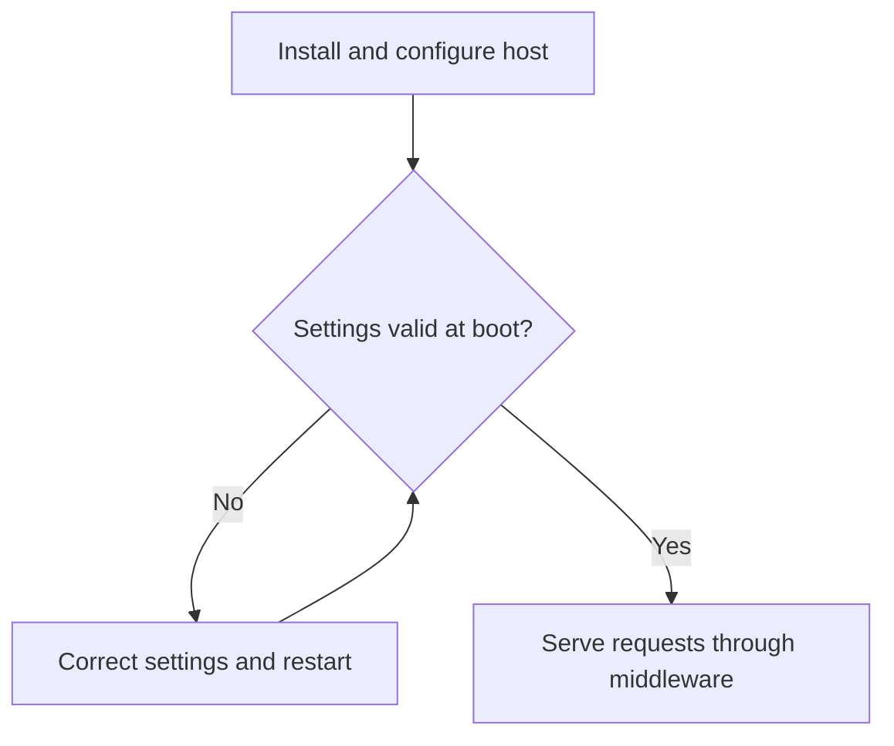
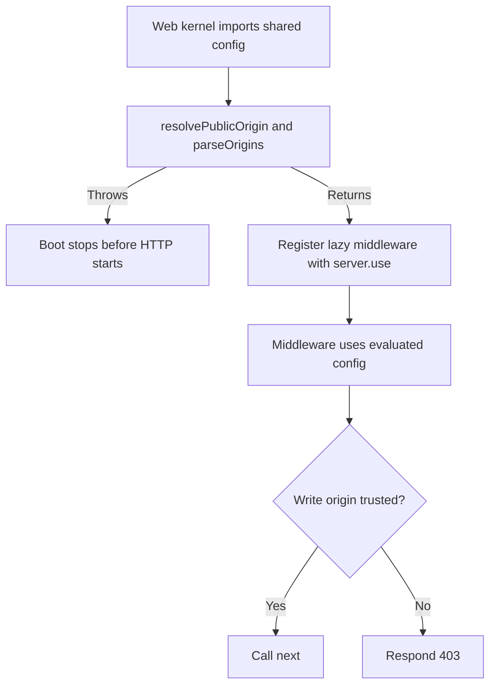

# US-ORIGIN-05 — Install the guard and validate settings before serving requests

As an application developer, I want the HTTP kernel to evaluate my trust settings during startup so that a configuration error surfaces before the first write.

**Status:** Operator.
**Access:** Developer with control of the host application, its dependencies and its HTTP kernel.
**Entry:** Install the GitHub release tarball and register the returned middleware class with `server.use`.
**Documentation:** [Installation and host wiring](../README.md#install).
**Source:** [Package exports](../index.ts), [type entry](../types.ts), [manifest](../package.json).
**Coverage:** [Web startup fixture](../tests/origins/origin_check/boot.spec.ts) and [packed consumer checks](../bin/smoke_packed_package.sh).

## Acceptance criteria

- The documented release installation targets Node 24+ and AdonisJS core 7. Use `createOriginGuard` for the v0.2.1 example. At this source revision `createOriginCheck` is the same factory. The root and `./types` expose the same declarations for `OriginGuardConfig`, `PublicOrigin` and `UnsafeRequestHeaders`.
- The host declares required `APP_URL` and optional `CORS_ORIGINS` in its environment schema. Its shared module validates the former with `NODE_ENV` and passes an empty string to the list parser when the latter is omitted.
- The kernel eagerly imports that module and registers a lazy middleware import ahead of handlers that act on writes. Invalid public URL or trusted-list settings stop startup before the HTTP listener. The operator corrects the reported setting and restarts.
- With valid settings the host starts. On the fixture's POST endpoint an untrusted origin receives 403 and a trusted origin reaches the handler and receives 200. The host owns registration and the handler's success response.
- Hosts can call the exported parsing functions independently of middleware registration.

## User flow

## Code flow

**Code references:** [Fixture kernel](../tests/origins/origin_check/fixture/start/kernel.ts), [decision logic](../src/origin_check.ts).
